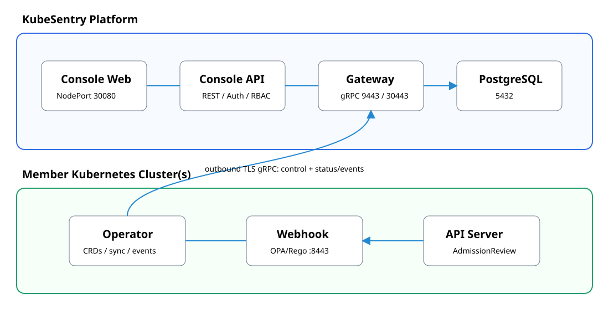
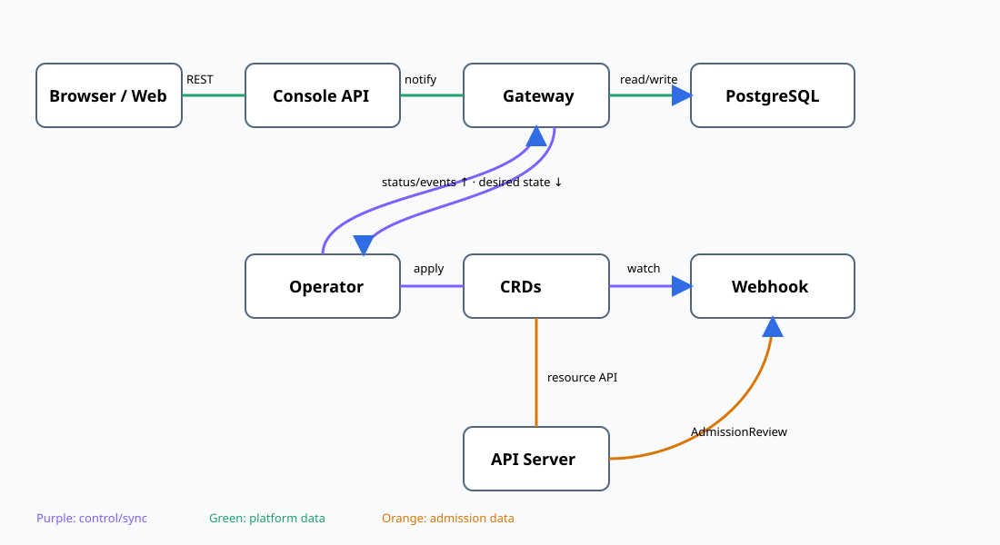

<p align="center"><br><strong>KubeSentry</strong></p>
<p align="center">Kubernetes admission security for multi-cluster, multi-tenant environments</p>
<p align="center">English · <a href="README_zh.md">中文</a></p>

[](https://go.dev/) [](https://kubernetes.io/) [](LICENSE)

KubeSentry evaluates security, reliability, and efficiency policies with OPA/Rego during Kubernetes admission. Its platform plane manages identities, tenants, clusters, policy distribution, events, and observability while lightweight Operator and Webhook components run in member clusters.

## Highlights

- Multi-cluster registration, health sync, tenant assignment, and safe uninstall.
- Server-enforced system administrator, tenant administrator, and viewer roles.
- Globally shared policies, tenant groups, exceptions, audit/enforce modes, and rollback.
- 37 built-in rules, admission-event search, storage controls, and platform observability.
- Chinese/English console, API reference, and authenticated help center.

## Deployment architecture



| Plane | Component | Responsibility |
|---|---|---|
| Platform | Console Web / API | UI, identity, authorization, and REST APIs |
| Platform | Gateway | Registration, sync, distribution, and event intake |
| Platform | PostgreSQL / DB Job | Persistence and migrations |
| Member | Operator | Gateway link, desired state, CRDs, and status reporting |
| Member | Webhook / Events | Admission evaluation and event collection |

## Component and data flow



Each member Operator initiates a TLS gRPC stream to Gateway; the platform needs no inbound access to member clusters. See [architecture](docs/en-US/architecture.md).

## Quick install

Requires Kubernetes 1.28+, Helm 3.8+, a default StorageClass, and member-to-Gateway connectivity.

```bash
helm install kubesentry-gateway ./charts/kubesentry-gateway \
  --namespace kubesentry-system --create-namespace
```

Open `http://<NodeIP>:30080` and initialize the default `admin` account. In production use HTTPS and set `console.session.cookieSecure=true`. Create a cluster in Console, then run its generated one-time Helm command in the member cluster. See [installation](docs/en-US/installation.md).

## Network requirements

| Source | Destination | Default port | Purpose |
|---|---|---:|---|
| Browser | Console | TCP 30080 (Service 8080) | Web UI |
| Member Operator | Gateway | TLS/TCP 30443 (Service 9443) | Registration, sync, reporting |
| Console API | Gateway | TCP 9443 | Platform communication |
| Platform | PostgreSQL | TCP 5432 | Data access |
| kube-apiserver | Webhook | TCP 443 (container 8443) | AdmissionReview |
| Webhook | Operator Events | TCP 8082 | Events and samples |

Components also require Kubernetes API TCP 443, DNS UDP/TCP 53, and outbound HTTPS TCP 443 for image pulls. See [network policy and ports](docs/en-US/network.md).

## Security rule sources and design references

Rules draw on public [Fairwinds Polaris](https://github.com/FairwindsOps/polaris) practices and are independently implemented for KubeSentry's multi-cluster, tenant authorization, and Rego model. This is a general design reference, not rule-by-rule compatibility. Evaluate in `audit` before enabling `enforce`.

## Documentation

- [Installation](docs/en-US/installation.md) · [Architecture](docs/en-US/architecture.md)
- [Network](docs/en-US/network.md) · [Maintenance guide](docs/en-US/documentation-maintenance.md)
- Sign in and open **System → Help Center**.

## Development

```bash
make test && make build
helm lint charts/kubesentry-gateway charts/kubesentry
cd web && npm test && npm run build
```

Changes to features, permissions, APIs, components, ports, or Helm values must update both languages and the help center per the [maintenance guide](docs/en-US/documentation-maintenance.md).

## License

[Apache License 2.0](LICENSE)
